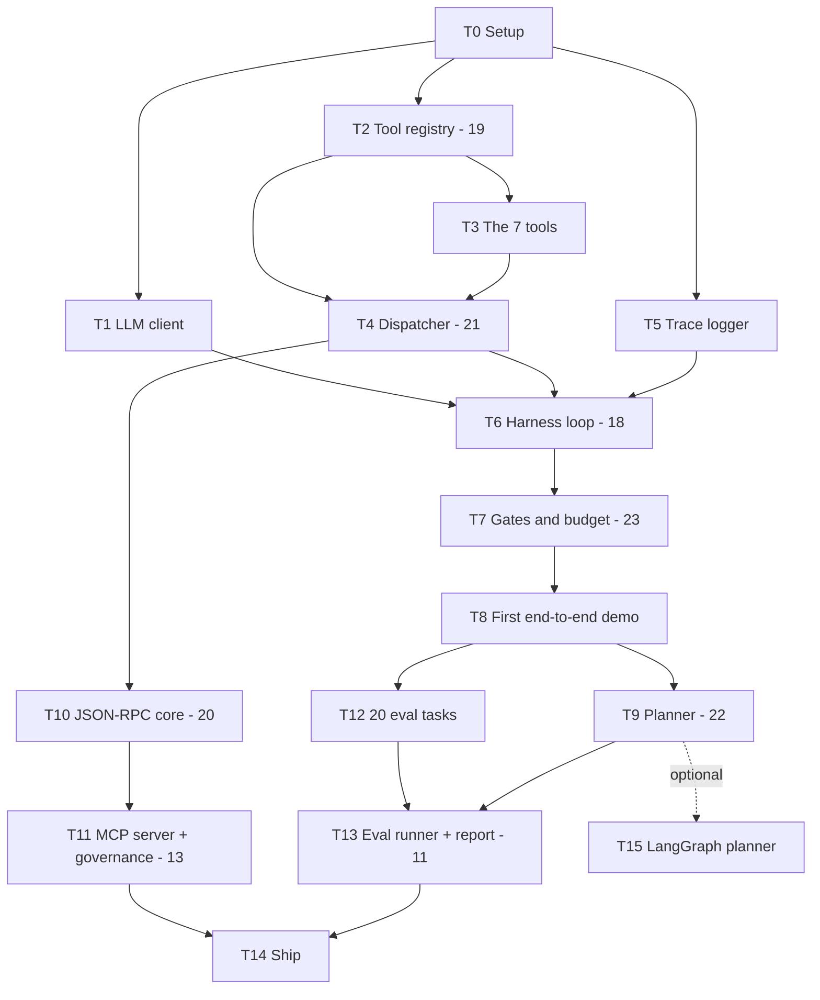

# Forge task graph

Work top to bottom. A task can start only when every task in its "Needs" line is ticked.
Times are budgets, not promises. Total: about 20 hours over 2 days.



Numbers in brackets (19, 21, ...) are the item numbers from the original project list.

---

## Day 1 — a working agent

### [x] T0 Setup — 45 min
Needs: nothing
Steps:
1. `uv init forge && cd forge`, then `uv add openai pydantic typer python-dotenv rich` and `uv add --dev pytest`.
2. Make the package folder `forge/` with empty files: `cli.py llm.py registry.py tools.py dispatch.py trace.py loop.py gates.py planner.py jsonrpc.py mcp_server.py evals.py`.
3. In `pyproject.toml` add a script entry: `forge = "forge.cli:app"`.
4. `.env.example` with `FORGE_BASE_URL`, `FORGE_API_KEY`, `FORGE_MODEL`. Add `.env` to `.gitignore`.
5. `cli.py`: a Typer app with empty commands `run`, `tools`, `serve`, `eval`.
6. Create `docs/LOG.md`. First commit.
Done when: `uv run forge --help` lists the 4 commands and `uv run pytest -q` runs (0 tests is fine).

### [ ] T1 LLM client — 45 min
Needs: T0
Contract:
```python
@dataclass
class LLMReply:
    text: str | None                 # what the model said, if anything
    tool_calls: list[ToolCall]       # what tools it wants to run (may be empty)
    tokens_in: int
    tokens_out: int

@dataclass
class ToolCall:
    id: str          # the model's id for this call; we must echo it back
    name: str
    arguments: str   # raw JSON string from the model, NOT parsed yet

def chat(messages: list[dict], tools: list[dict]) -> LLMReply: ...
```
Steps: use `openai.OpenAI(base_url=..., api_key=...)` and `client.chat.completions.create(model, messages, tools)`.
Read `choice.message.content`, `choice.message.tool_calls` (each has `.id`, `.function.name`, `.function.arguments`),
and `response.usage`. Retry once on a network error.
Done when: a one-off script sends "say hi" and prints the reply and the token counts.
Interview questions:
- Why keep `arguments` as a raw string here instead of parsing it?
- Why one small wrapper instead of calling the SDK everywhere?
- How would you switch to a different provider?

### [ ] T2 Tool registry (19) — 1 h 15 min
Needs: T0
Contract:
```python
@dataclass
class ToolSpec:
    name: str
    description: str          # tells the model WHEN to use it and when NOT to
    args_model: type[BaseModel]
    fn: Callable[[BaseModel, "Context"], str]

REGISTRY: dict[str, ToolSpec] = {}

def tool(name: str, description: str, args_model: type[BaseModel]): ...   # decorator
def openai_schemas(allow: set[str] | None = None) -> list[dict]: ...
```
`openai_schemas` returns `[{"type": "function", "function": {"name", "description", "parameters": args_model.model_json_schema()}}]`.
Done when: tests show a registered tool appears in `openai_schemas()` with a correct JSON Schema, and a duplicate name raises an error.
Interview questions:
- Why generate the JSON Schema from Pydantic instead of writing it by hand?
- What makes a good tool description?
- Why is the registry a single source of truth for both the agent and the MCP server?

### [ ] T3 The 7 tools — 1 h
Needs: T2
Tools (each with its own Pydantic args model):
| Tool | Args | Notes |
| --- | --- | --- |
| `read_file` | path, start_line?, end_line? | add line numbers to output |
| `write_file` | path, content | creates folders if needed |
| `edit_file` | path, old_text, new_text | old_text must appear exactly once, else error text |
| `list_dir` | path | skip `.git`, `__pycache__`, `.venv` |
| `grep` | pattern, path | plain Python search, max 50 hits |
| `run_tests` | path? | `pytest -q -x` with timeout |
| `finish` | summary | the model calls this when done |

`Context` holds `workspace: Path`. Every path goes through `safe_path(ctx, p)`, which resolves it and
raises if it is outside the workspace. A `run_shell` tool is optional; if added, use `shlex.split`,
an allowlist of first words (`ls`, `cat`, `python`, `pytest`), never `shell=True`.
Done when: tests cover each tool once, `edit_file` with 0 or 2 matches returns an error, and `../secret.txt` is blocked.
Cut if late: drop `grep` and `list_dir` options, keep them minimal.
Interview questions:
- Why does `edit_file` replace exact text instead of rewriting the whole file?
- How do you stop the agent from reading `/etc/passwd`?
- Why is `finish` a tool instead of just waiting for the model to stop talking?

### [ ] T4 Dispatcher (21) — 1 h
Needs: T2, T3
Contract:
```python
@dataclass
class ToolResult:
    ok: bool
    output: str        # what the model will read
    latency_ms: int

def dispatch(call: ToolCall, ctx: Context, allow: set[str] | None = None) -> ToolResult: ...
```
Order: unknown name → error text listing valid names · `json.loads` fails → error text ·
`args_model.model_validate` fails → error text with the Pydantic message · run the tool ·
tool raises → error text with the exception type and message · always measure time.
Commands use `subprocess.run(..., timeout=30, capture_output=True, text=True)`; catch `TimeoutExpired`.
Done when: tests pass for unknown tool, broken JSON, wrong types, a tool that raises, and a timeout.
Interview questions:
- Why send errors back to the model as text instead of crashing?
- What if a tool hangs forever?
- What is the difference between an error the model caused and a bug in our code?

### [ ] T5 Trace logger — 30 min
Needs: T0
Contract: `class Tracer` with `__init__(run_dir: Path)`, `log(event: str, **fields)` that appends one JSON line
to `run_dir/trace.jsonl` with a timestamp, and `summary() -> dict` (steps, tool calls, errors, tokens in/out, total ms).
Done when: a test logs 3 events and `summary()` adds them up correctly.
Interview questions:
- Why JSONL instead of one big JSON file?
- What would you look at first when a run fails?
- How is this related to OpenTelemetry-style tracing?

### [ ] T6 Harness loop (18) — 2 h 30 min
Needs: T1, T4, T5
Contract:
```python
@dataclass
class RunConfig:
    workspace: Path
    max_steps: int = 25
    gates: bool = True
    mode: Literal["react", "plan"] = "react"
    output_budget: int = 4000      # max characters of tool output sent to the model

@dataclass
class RunResult:
    status: Literal["finished", "max_steps", "error"]
    steps: int
    tokens_in: int
    tokens_out: int
    summary: str

def run(task: str, cfg: RunConfig) -> RunResult: ...
```
The loop, in words:
1. messages = [system prompt, user task].
2. Repeat up to `max_steps`: call `chat(messages, tools)`.
3. Add the model's reply to messages (including its tool calls).
4. No tool calls → stop with status `finished`.
5. For each tool call: `dispatch` it, pass the result through `gates.after_tool(...)` (T7; for now just return it),
   add `{"role": "tool", "tool_call_id": call.id, "content": output}` to messages, log it.
6. If the call was `finish` → stop with status `finished`.
7. Out of steps → status `max_steps`.
Wire `forge run` in `cli.py` to print each step with `rich`.
Done when: a test with a FAKE `chat` function (scripted replies, no network) runs read → edit → finish
and ends `finished` in 3 steps; another fake that never stops ends `max_steps`.
Interview questions:
- How does the agent know when to stop? Name every way it can stop.
- Why must every tool result carry the same `tool_call_id`?
- Why test the loop with a fake model?

### [ ] T7 Gates and budget (23) — 1 h 45 min
Needs: T6
Contract:
```python
def truncate(text: str, limit: int) -> str: ...
# keeps the first ~60% and last ~40%, puts "[... N characters cut ...]" in the middle

def after_tool(call: ToolCall, result: ToolResult, cfg: RunConfig, ctx: Context) -> str: ...
# 1) truncate the output to cfg.output_budget
# 2) if cfg.gates and the tool was write_file or edit_file and it succeeded:
#    run pytest in the workspace and append a SHORT line: "GATE: 4 passed, 1 failed (test_add)"
```
Add `--no-gates` to `forge run`. Log every gate result to the trace.
Done when: tests show truncation keeps head and tail, a gate line is added after a successful edit,
and no gate line appears with gates off.
Cut if late: only report the pass/fail counts, not the failing test names.
Interview questions:
- Why check the work automatically instead of trusting the model?
- Why keep the end of long output, not just the start?
- What is "context engineering" and how does the budget relate to it?

### [ ] T8 First end-to-end demo — 45 min
Needs: T7
Make `examples/toy_bug/` with `calc.py` (an off-by-one bug) and `test_calc.py` (one failing test).
Run `uv run forge run "Make the tests pass" --workspace examples/toy_bug` with gates on and off.
Read both trace files. Write 3 lines in `docs/LOG.md` about what you saw.
Done when: the agent fixes the bug at least once and the trace shows every step.

---

## Day 2 — plan mode, MCP server, evals, shipping

### [ ] T9 Planner (22) — 1 h 45 min
Needs: T8
Contract:
```python
class Plan(BaseModel):
    steps: list[str]          # 1 to 8 short steps

def make_plan(task: str, ctx: Context) -> Plan: ...
def run_plan(task: str, cfg: RunConfig) -> RunResult: ...
```
`make_plan` asks the model for JSON only, validates it with `Plan.model_validate_json`, and retries once on failure.
`run_plan` runs each step as a small ReAct loop (reuse `run` with a lower `max_steps`). If a step fails,
ask for a new plan ONCE, then continue. `forge run --mode plan` uses it.
Done when: a fake-model test runs a 2-step plan, and the toy bug is fixed in plan mode.
Cut if late: no re-planning; just run the steps in order.
Interview questions:
- When is plan-then-act better than one step at a time? When is it worse?
- What happens if the plan JSON is broken?
- Why limit re-planning to once?

### [ ] T10 JSON-RPC core (20) — 1 h
Needs: T4
Contract:
```python
def handle_line(line: str, methods: dict[str, Callable[[dict], dict]]) -> str | None: ...
# returns one JSON line to write back, or None for a notification (a message with no "id")
```
Rules (JSON-RPC 2.0): bad JSON → error `-32700`; not a valid request object → `-32600`;
unknown method → `-32601`; bad params → `-32602`; our bug → `-32603`.
Every reply has `"jsonrpc": "2.0"` and the same `"id"` as the request. Output must be ONE line (no newlines inside).
Done when: tests cover a good call, each of the 5 error codes, and a notification that gets no reply.
Interview questions:
- What is the difference between a request and a notification?
- Why must a stdio message never contain a newline?
- Why does `handle_line` not touch stdin/stdout itself?

### [ ] T11 MCP server + governance (13) — 1 h 30 min
Needs: T10
First read the stdio page of the current MCP spec (2026-07-28):
https://modelcontextprotocol.io/specification/2026-07-28/basic/transports/stdio
and the schema page for the exact shapes of `server/discover`, `tools/list` and `tools/call`.
This version is stateless: no `initialize` handshake; the protocol version is sent in each request's `_meta`.
Build:
- `server/discover` → server name, version, supported protocol versions (check the exact shape in the schema).
- `tools/list` → every allowed tool as `{name, description, inputSchema}` (reuse the registry's schemas).
- `tools/call` with `{name, arguments}` → run through `dispatch`, return `{"content": [{"type": "text", "text": ...}], "isError": not ok}`.
- Governance: `forge.toml` with `allow = ["read_file", "list_dir", "grep"]` (start read-only),
  and an audit log `audit.jsonl` with time, tool, ok, latency for every call.
- `forge serve` loops: read a line from stdin → `handle_line` → write the reply + newline to stdout → flush. Logs go to stderr.
- `scripts/mcp_client.py`: starts `forge serve` with `subprocess.Popen`, sends `tools/list` and one `tools/call`, prints the replies.
Done when: the client script works, a blocked tool returns an error, and the audit log has a line per call.
Cut if late: skip `server/discover`; keep `tools/list` and `tools/call`.
Interview questions:
- Explain MCP in 30 seconds. Why does it exist?
- What did "stateless" change in the 2026 spec, and why is it easier to scale?
- Why start the allowlist read-only?

### [ ] T12 The 20 eval tasks — 1 h 30 min
Needs: T8
Folder per task: `evals/tasks/NN-name/` with `src/*.py`, `tests/test_*.py` (fails now), `task.txt` (one-line instruction),
and `fix.patch` or `solution/` (the correct fix, never shown to the agent).
Write 10 bugs yourself (off-by-one, wrong operator, wrong default, missed empty input, wrong sort key, ...).
Draft 10 more with an LLM and check each by hand: the test fails before the fix and passes after it.
Done when: a script confirms all 20 fail before and pass with the solution applied.

### [ ] T13 Eval runner + report (11) — 1 h 30 min
Needs: T9, T12
`forge eval --runs 3` does, for each task and each setting (gates on, gates off, plan mode):
copy the task to a temp folder → run the agent → run pytest OURSELVES to judge pass/fail (never trust the agent's own claim) →
record pass, steps, tokens in/out, seconds, tool errors. Write `results/results.csv` and `results/results.md`:
| Setting | Pass rate | Avg steps | Avg tokens | Avg seconds | Tool-call error rate |
Done when: the full eval runs once and the table is filled with real numbers.
Cut if late: 10 tasks, 2 settings (gates on / off), 2 runs.
Interview questions:
- Why does the harness re-run the tests instead of trusting the agent?
- Why 3 runs per task?
- Your pass rate went from X to Y. How sure are you that it is real?

### [ ] T14 Ship — 1 h 30 min
Needs: T11, T13
- `Dockerfile` (python slim, `uv sync`, entrypoint `forge`).
- `.github/workflows/ci.yml`: install with uv, run `pytest -q` (fake model only, no API key needed).
- `README.md`: one-paragraph pitch, the architecture diagram, quick start, the results table from T13,
  design choices and limits (what it cannot do).
- A terminal recording with asciinema of one real fix.
Done when: a fresh clone builds with Docker and runs `forge eval --tasks 3`, and CI is green.

### [ ] T15 Optional: LangGraph planner — 1 h
Needs: T9 (only if ahead of schedule)
Rebuild `run_plan` as a LangGraph `StateGraph` with `plan`, `execute`, `replan` nodes and a conditional edge.
Run the eval in plan mode with both versions. Only then add "LangGraph" to the resume.
Interview question: what did the framework hide that you had to write yourself in T9?
